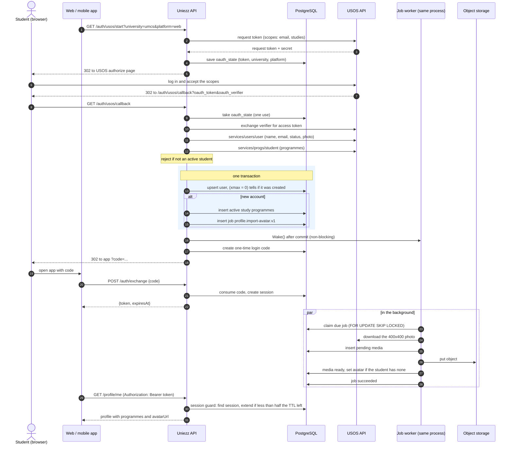

# USOS login flow

How a student at a USOS university (UMCS, UMLub) logs in, from the first click to the imported avatar.

## Sequence

## Steps

1. **Start.** The API asks USOS for a request token with the `email` and `studies` scopes and stores it in `oauth_states` with the university and the platform to return to. The browser goes to the USOS authorize page.
2. **Callback.** USOS sends the browser back with the request token and a verifier. The API takes the stored state (each state works once), exchanges the verifier for an access token and reads:
   - `services/users/user`: `id`, names, `email`, `student_status`, `has_photo`, `photo_urls[400x400]`;
   - `services/progs/student`: each programme's `status`, `is_primary`, name, `level`, mode of studies and faculty.

   A login is refused unless `student_status` is active. If the programmes request fails, the login still succeeds without programmes and a warning is logged.
3. **Sign in.** The user upsert and the profile seed run in one transaction (`logins.signIn`):
   - The upsert returns `xmax = 0` only when the row was inserted, so the API knows the account is new.
   - Only for a new account, `profile.SeedAccount` inserts the active programmes (names in Polish, English as a fallback; exactly one is primary) and enqueues `profile.import-avatar.v1` if USOS shares a photo.
   - Later logins update `last_login_at` and fill names that are still empty; they never overwrite what the student edited and never import programmes again.
   - If anything fails, nothing is kept: no user, no programmes, no job.
4. **Wake the worker.** After the commit, the API wakes the job worker. Login does not wait for the import.
5. **Login code.** The browser goes back to the app with a one-time code, which the app exchanges for a session token (`POST /auth/exchange`).
6. **Avatar import.** The worker downloads the photo, stores it as avatar media and sets `users.avatar_media_id` only if it is still empty, so a photo the student uploaded in the meantime wins. Failures are retried with backoff; see [jobs](../jobs.md).
7. **Protected calls.** Every operation declared with bearer security goes through the session guard. It returns the same `401` for a missing, malformed, unknown or expired token, and pushes `expires_at` to now + 30 days when less than 15 days are left.

## Where the code is

| Step | Code |
|------|------|
| Start and callback handlers | `internal/auth/usos_handler.go` |
| USOS state and token exchange | `internal/auth/usos_login.go`, `internal/usos/usos.go` |
| USOS data to profile seed | `internal/auth/usos_seed.go` |
| Transactional sign-in | `internal/auth/login.go`, `internal/auth/user_repository.go` |
| Seed and import task | `internal/profile/seed.go`, `internal/profile/import_avatar_task.go` |
| Download and store the photo | `internal/media/import.go` |
| Session guard | `internal/auth/guard.go` |
