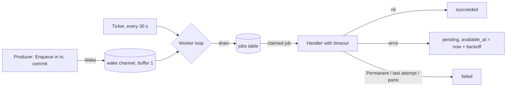

# Background jobs

`internal/jobs` runs durable tasks inside the API process. Jobs live in the `jobs` table; the database is the source of truth, and the in-process wakeup only shortens pickup time.

## Words

- **Task**: a named operation with a typed payload. The args struct names it through `Kind()`, e.g. `ImportAvatarArgs` is `profile.import-avatar.v1`.
- **Handler**: the function that performs a task.
- **Job**: one row in `jobs`, i.e. one request to run a task with a payload.
- **Worker**: a goroutine that claims jobs and runs their handlers. `JOB_WORKERS` (default 1) sets how many run at once.

## Adding a task

Everything lives in the module that owns the work, in `<task>_task.go`:

```go
type SendDigestArgs struct {
    UserID uuid.UUID `json:"userId"`
}

func (SendDigestArgs) Kind() string { return "feed.send-digest.v1" }

func (m Module) sendDigest(ctx context.Context, args SendDigestArgs) error {
    // Return nil on success, an error to retry, jobs.Permanent(err) to give up.
}
```

Register the handler in the module's `New`; registering the same task twice fails startup:

```go
err := jobs.Register(runner, m.sendDigest, jobs.Options{Timeout: 30 * time.Second, MaxAttempts: 5})
```

Enqueue inside the transaction that makes the job necessary, then wake the runner after the commit:

```go
err := pgx.BeginFunc(ctx, db, func(tx pgx.Tx) error {
    // ... your writes ...
    return jobs.Enqueue(ctx, tx, SendDigestArgs{UserID: id})
})
if err == nil {
    runner.Wake()
}
```

The type parameter ties the three together: the compiler rejects a payload of the wrong type in `Enqueue` and a handler with the wrong argument type in `Register`. Changing the payload in a way old rows cannot decode needs a new task name (`.v2`).

Handlers must be safe to run twice (delivery is at least once): a worker can finish the work and crash before it records success.

## How the runner works



`Runner.Run(ctx)` starts `JOB_WORKERS` goroutines and waits for all of them to stop. Each worker repeats:

1. **Drain**: claim and run jobs one by one until none is due. This also runs right after startup, so jobs committed before a restart are picked up without a wakeup.
2. **Wait** for whichever comes first:
   - the context is cancelled (shutdown): return;
   - a value on the wake channel: drain again;
   - the ticker fires (every 30 s): drain again. This catches due retries and expired leases.

The wake channel has a buffer of one, and `Wake` never blocks: if a wakeup is already waiting, another one adds nothing. A wakeup only means "look at the table"; the job itself is always read from PostgreSQL. A worker that claims a job also calls `Wake`, so an idle second worker joins in when there is more work.

### Claiming

One statement picks the oldest due job of a registered kind and marks it running:

- `FOR UPDATE SKIP LOCKED` makes concurrent workers skip a row another worker is claiming, so two workers never get the same job.
- `attempts` is incremented, `locked_until` is set to now + lease (the longest task timeout + 30 s), and a fresh `execution_token` is written.
- A job is due when it is `pending` with `available_at <= now`, or `running` with an expired lease (its worker died).

The claim commits before the handler runs, so no transaction stays open during network or storage I/O.

### Finishing

The handler runs with the task's timeout. Then the worker records the result, always with `WHERE id = $1 AND execution_token = $2`. If the lease expired and another worker re-claimed the job, the token no longer matches and the stale result is ignored.

| Outcome | New state |
|---------|-----------|
| `nil` | `succeeded` |
| error, attempts left | `pending`, `available_at` = now + backoff: 10 s doubling up to 10 min, randomised to between half and the full delay |
| `jobs.Permanent(err)`, last attempt, panic, payload that does not decode | `failed`, reported to Sentry |
| lease expired and no attempts left | `failed` without running |

A retry does not block the worker: it moves on to other due jobs.

### Shutdown

On SIGTERM, `main` stops the HTTP server first, then cancels the runner's context. Workers stop claiming; a running handler sees its context cancelled, and its job goes back to `pending` for the next start (or fails if that was its last attempt). `main` waits for the workers within the shutdown timeout.

## Observability

Every finished attempt is logged with `job_kind`, `job_id` and `attempt`. Retries are `WARN`; final failures go through `telemetry.ReportError` and create a Sentry issue. Pending jobs of a kind with no registered handler are reported once at startup.

## Tasks

| Kind | Owner | What it does |
|------|-------|--------------|
| `profile.import-avatar.v1` | profile | Copies the USOS photo of a new account into our storage and sets it as the avatar, unless the student already chose one. |

## Operations

Failed jobs stay in the table with `last_error`. Inspect them:

```sql
SELECT id, kind, attempts, last_error, finished_at
FROM jobs
WHERE status = 'failed'
ORDER BY finished_at DESC;
```

After fixing the cause, retry one deliberately:

```sql
UPDATE jobs
SET status = 'pending', attempts = 0, available_at = NOW(), finished_at = NULL
WHERE id = '<job id>' AND status = 'failed';
```

Check backlog age before raising `JOB_WORKERS`:

```sql
SELECT kind, count(*), min(available_at)
FROM jobs
WHERE status = 'pending' AND available_at <= NOW()
GROUP BY kind;
```
